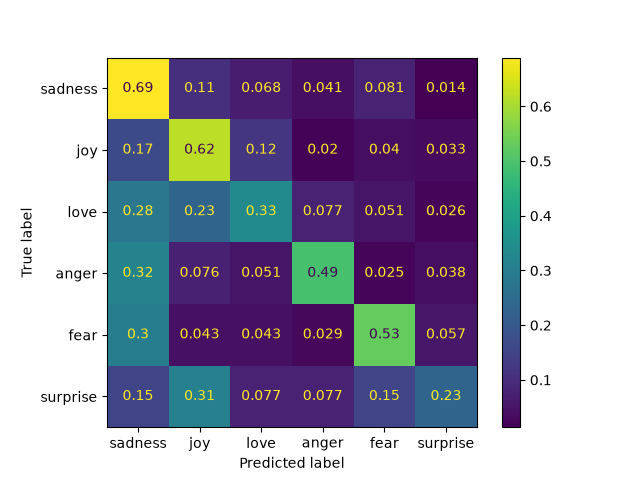
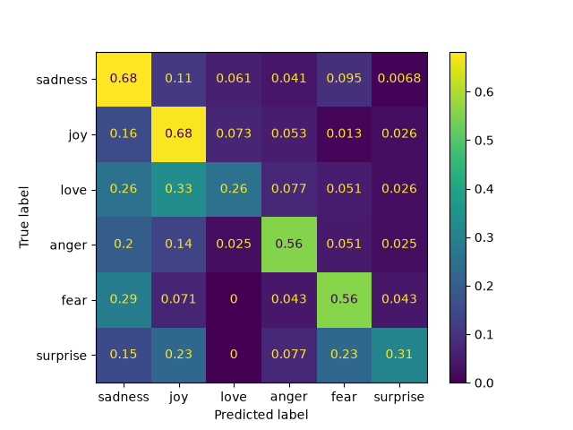
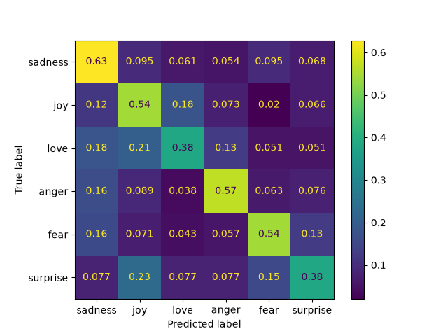

# Model Eval Harness

This project compares three language models on the same small task and measures how well
each one does. The task is emotion classification: the model reads a short text such as
"i feel so happy" and has to answer with one of six emotions (sadness, joy, love, anger,
fear, surprise). The dataset contains the correct answer for every text, so each model's
answers can be scored automatically.

The goal is not to name a winner. The goal is to build the machinery around the comparison
so that the numbers can be trusted: every model sees exactly the same input, every call is
recorded, failures are counted instead of hidden, and every number in this README can be
recomputed from the files in this repository without calling any API.

| Model | Provider | Notes |
| --- | --- | --- |
| `gpt-4o-mini` | OpenAI | small proprietary model |
| `gemini-3.5-flash-lite` | Google | small proprietary model |
| `qwen/qwen3.8-27b` | Groq (made by Alibaba) | open model, larger than the other two, hosted by Groq |

The Qwen model is larger than the other two, so the comparison is "three models people might
reasonably pick for a cheap task", not a comparison of equal sizes.

## Results

Each model classified the first 500 texts of the dataset's test split, once, in October 2026.

| Model | Rows | Accuracy (%) | 95% margin | Macro-F1 | Invalid | Unprocessed |
| --- | --- | --- | --- | --- | --- | --- |
| gemini | 500 | 60.0 | ±4.3 | 0.511 | 0 | 0 |
| openai | 500 | 57.6 | ±4.3 | 0.486 | 0 | 0 |
| groq | 500 | 55.6 | ±4.4 | 0.482 | 0 | 0 |

**What the columns mean.** *Accuracy* is the share of texts where the model's answer matched
the dataset's label. The *95% margin* tells you how much that number could move if a
different set of 500 texts had been used: the true accuracy probably lies within about four
points of the measured one. *Macro-F1* is a second score that gives every emotion the same
weight, so rare emotions count as much as common ones. *Invalid* counts answers that were
not one of the six labels, and *Unprocessed* counts texts that never got an answer after
retries. Both are zero here: every model eventually produced a usable answer for every text.

**How to read the numbers.** Gemini scored highest and Groq lowest, but the gap between them
is 4.4 points, about the size of the margin of error of each number. The ranges overlap, so
this run does not show that one model is better than another. All three models were scored
on the same texts, which means a paired statistical test could detect a smaller difference
than comparing ranges can. That test has not been run yet.

Macro-F1 is lower than accuracy for all three models (about 0.48 to 0.51 versus 0.56 to
0.60). This happens because macro-F1 weights every emotion equally, and the models do much
worse on the rare emotions (love and surprise) than on the common ones. The next section
shows where.

### Which emotions are easy and which are hard

Recall answers the question: of all texts whose true emotion is X, how many did the model
label X?

| Model | sadness | joy | love | anger | fear | surprise |
| --- | --- | --- | --- | --- | --- | --- |
| gemini | 0.68 | 0.68 | 0.26 | 0.56 | 0.56 | 0.31 |
| openai | 0.69 | 0.62 | 0.33 | 0.49 | 0.53 | 0.23 |
| groq | 0.63 | 0.54 | 0.39 | 0.57 | 0.54 | 0.39 |

Sadness has the highest recall for all three models (0.63 to 0.69; Gemini scores the same on
joy). Love is the hardest (0.26 to 0.39). In the OpenAI results, texts whose label is love were
most often answered as sadness or joy. Surprise has only about 13 texts in this sample, so one
text changes its recall by roughly 8 points, and the differences between models on surprise
(3, 4 and 5 correct answers out of 13) amount to a couple of texts and should not be read as a
real difference.

### Confusion matrices

A confusion matrix shows what the model answered for each true emotion. Each row is a true
emotion, each column is the model's answer, and each cell is the share of that row's texts.
A perfect model would have a bright diagonal and nothing elsewhere.





The clearest pattern, checked on the OpenAI results, is that the model over-predicts
sadness. About 40% of all its mistakes were cases where it answered "sadness", and fear,
anger, joy and love were all often labeled as sadness.

## The data and why accuracy stays near 60%

The data is the test split of [`dair-ai/emotion`](https://huggingface.co/datasets/dair-ai/emotion),
a collection of English Twitter messages, each with one of six emotion labels. The test split
has 2,000 texts, and this project uses the first 500. The dataset comes from the paper CARER
(Saravia et al., 2018). Three things about it affect how the results should be read.

**The labels are noisy.** According to the paper, the labels were not assigned by people
reading each text. The authors collected tweets that used emotion-related hashtags and treated
the hashtag as a stand-in for the true label (a technique called distant supervision), which
they themselves describe as producing noisy labels. As a result, the label follows the hashtag
the author chose and not necessarily the meaning of the whole sentence. For example, the dataset
labels "i didnt feel humiliated" as sadness and "i don t feel particularly agitated" as fear,
although both sentences say the opposite. A model that reads the sentence the way a person
would gets such texts "wrong". This puts a ceiling on zero-shot accuracy, so the numbers are
best used to compare models with each other, not to judge them against 100%.

**The sample is not balanced.** Sadness and joy are the most common labels, and surprise has
only about 13 texts in the first 500. That is why the surprise results are unreliable here:
one text moves its recall by about 8 points.

**The models may have seen this data before.** The dataset is public and widely used, so it
may have been part of the models' training data. If so, the scores could be slightly better
than they would be on unseen texts.

## How a run works

A run goes through every text and sends it to every model. Each model gets the same
instruction (the system prompt in `classifier.py`, which lists the six emotions and asks for
the dominant one) and the text as the user message. The answer is requested in a fixed
format through LangChain's `with_structured_output`, so the model must pick one of the six
labels. OpenAI and Groq run with temperature 0. Gemini 3.5 Flash-Lite does not accept a
temperature setting, so it was left unset, which means its answers may vary slightly between
runs.

Every call ends in one of three outcomes:

| Status | What happened | How it is counted |
| --- | --- | --- |
| `ok` | the model returned a valid label | correct or wrong |
| `invalid` | the call worked, but the answer could not be read as a label | wrong |
| `error` | the call itself failed (rate limit, API error) | not scored, retried |

Every attempt is appended to a log file in `predictions/`, and nothing is ever overwritten.
This matters because a text that fails twice and then succeeds has three lines in the log,
and those lines are the evidence of how unreliable a model was. If a run is stopped, running
the classifier again skips the texts that already have an answer and retries the ones that
failed.

Before scoring, a cleaning step (`cleaner.py`) reduces the log to one line per text: the last
attempt wins, and texts whose last attempt was still an error are dropped and counted as
unprocessed. The scoring code then matches each prediction to the dataset's correct answer
using `row_id`, which is the text's row number in the dataset file. Matching on the row number
is safer than matching on position or on the text itself, because the raw log is not in order
and the same sentence can appear twice.

Accuracy counts invalid answers as wrong, because an unusable answer is a failure of the
model. Macro-F1 and the confusion matrices leave them out, because they need a real label on
both sides. The invalid count is always shown next to them.

## Known issue: Qwen on Groq and tool calling

LangChain's structured output works by presenting the answer format to the model as a "tool"
that it has to call. Qwen on Groq was unreliable at this. Groq checks every tool call, and
for many texts it rejected Qwen's call with an HTTP 400 error (`tool_use_failed`). In most
failed calls the emotion Qwen picked looked reasonable, but the call itself was malformed:

- the tool name was written wrongly (`Emotion Prediction`, `Emotionprediction`,
  `EmotionRecognition` instead of `EmotionPrediction`)
- stray characters from other languages ended up inside the tool or parameter names
- the answer was put in a made-up `url` or `text` parameter instead of `label`

The table counts first attempts, taken from the raw log in `predictions/`:

| | OpenAI | Gemini | Groq |
| --- | --- | --- | --- |
| Texts whose first attempt failed (any reason) | 0 | 40 | 217 |
| of which tool-call errors (`tool_use_failed`) | 0 | 0 | 170 |
| of which rate limits (429) | 0 | 40 | 47 |
| Texts that needed more than one attempt | 0 | 40 | 217 |
| Most attempts needed for one text | 1 | 3 | 9 |

For Groq, 170 of the 500 texts (34%) failed on the first attempt because Qwen produced a
malformed tool call. A further 47 texts (9%) failed because the daily token limit had been
reached, which is a quota problem and not a model problem. In total, 217 texts (43%) needed at
least one retry, and one text needed 9 attempts. Gemini had 40 first-attempt failures (8%), all
rate-limit errors, and every text was answered within 3 attempts. OpenAI answered every text on
the first attempt.

Failed texts were retried until they produced an answer, using the same retry rule for all
models, and in the end all 500 texts were answered. The label was never taken from the text
of a failed answer, because the other models do not get that chance. The cause of the
failures is not confirmed: it could be a weakness of the model, or something about how Groq
serves it. The logs only show what the model produced.

Groq's free tier also limits usage to 200,000 tokens per day, and failed attempts use tokens
too. The first pass reached that limit around text 453, and the remaining texts were retried
later. Those 47 rate-limit failures have their own row in the table above, because they are a
quota problem and not a Qwen problem. Gemini's 40 first-attempt failures were also rate-limit
errors, handled by the same retry rule.

## Running it

Install the dependencies and add your API keys. The `.env.example` file lists the variables
that are needed (one key per provider):

```bash
uv sync
cp .env.example .env
```

The project is a chain of small scripts. Only the classifier calls the paid APIs; the rest
read saved files, so everything after it can be rerun without any key.

```bash
uv run python -m model_eval_harness.load_dataset    # download the data into data/dataset.csv
uv run python -m model_eval_harness.classifier      # call the three models (costs money, resumable)
uv run python -m model_eval_harness.cleaner         # one final answer per text
uv run python -m model_eval_harness.evaluator       # compare with the correct labels
uv run python -m model_eval_harness.metrics         # confusion matrices and per-emotion scores
uv run python -m model_eval_harness.report          # build the results table
```

The number of texts is set by `N_ROWS` in `classifier.py` (500 here). The prediction files are
committed, so you can start at `cleaner` and reproduce every number in this README without any
API key. If `data/dataset.csv` is not in your checkout, run `load_dataset` first. It needs an
internet connection but no API key.

Tracing with LangSmith is optional. `classifier.py` is instrumented, but nothing is sent unless
`LANGSMITH_TRACING=true` and a LangSmith key are set in `.env`. Accounts in the EU region also
need `LANGSMITH_ENDPOINT=https://eu.api.smith.langchain.com`. The results in this README do not
depend on it.

## What is in the repository

```
data/                   dataset.csv (the texts and labels) and labels.txt (the label names)
predictions/            raw log: one line per attempt, per model
predictions_clean/      one final answer per text, finished texts only
evaluations/            per-text results (*_results.jsonl) and totals (*_summary.json)
metrics/                confusion matrices (.png) and per-emotion scores (*_metrics.json)
logs/calls.jsonl        one line per API call with status, tokens and timing (not used in the results yet)
results.md              the results table, generated by report.py
tests/                  unit tests
src/model_eval_harness/
  load_dataset.py       downloads the dataset and saves it as a CSV
  model.py              the six labels and the answer format the models must follow
  classifier.py         sends the texts to the models and records every attempt
  cleaner.py            reduces the raw log to one answer per text
  evaluator.py          compares predictions with the correct labels
  metrics.py            confusion matrices, precision, recall, F1
  report.py             builds the results table
```

The split between `predictions/` and `predictions_clean/` is deliberate: the first is the
untouched record of what happened, the second is derived from it and can be rebuilt at any
time.

## Tests

```bash
uv run pytest
```

The tests cover the code that the numbers depend on: the mapping from label names to
numbers, the counting of correct, wrong and invalid answers, reading files that contain blank
lines, and the matching of predictions with the dataset by `row_id`. They work on small
made-up files in a temporary folder, so they need no API key, make no network calls and do
not touch the real result files.

## Limitations

- **One run per model on 500 texts.** The margin of error is about four points, so small
  differences between models cannot be told apart from chance.
- **No speed or cost comparison.** The call log records timing and token counts, but they
  are not analysed, so the README says nothing about which model is faster or cheaper.
- **No baselines.** There is no "always answer the most common emotion" or simple
  keyword-classifier result to put the scores in context.
- **Only one prompt.** All models were tested zero-shot, with no examples in the prompt, so
  the results say little about how much a better prompt would help.
- **Gemini is not exactly reproducible**, because its temperature could not be fixed.
- **Groq took a different path.** Its answers came through many retries, so its result
  reflects the model plus the retry rule, not a clean first-attempt run.
- **Noisy labels and a possible overlap with training data** (see above).

## Possible next steps

- Add the baselines, so the scores can be judged against something simple.
- Run Groq with JSON mode or plain-text answers instead of tool calling, and report it as a
  separate row.
- Try a prompt with a few examples for all three models, to see how much of the result is
  the model and how much is the prompt.
- Run a paired test (a bootstrap or McNemar's test) to see whether any of the differences
  are real.
- Analyse the call log for speed and cost.
- Add automated checks (ruff and pytest) in CI.

## License and data terms

The code in this repository is released under the MIT License (see `LICENSE`).

The dataset has its own terms. Its card lists the license as "other" and says the dataset
should be used for educational and research purposes only. This project is an educational
experiment and uses the data under that condition.

Reference: Saravia, E., Liu, H.-C. T., Huang, Y.-H., Wu, J., Chen, Y.-S. (2018). CARER:
Contextualized Affect Representations for Emotion Recognition. EMNLP 2018.